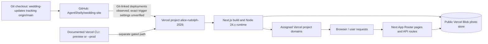

# Current deployment and request map

This map combines checked-in code with read-only platform metadata from the prior audit. Lines marked **external/unverified** were not confirmed by repository configuration. No deployment or production request was made for this document.

## Checkout to hosted build



### Observed and inferred steps

1. Current checkout is `wedding-updates`, tracking `origin/main`, at `ff0608e7f11700bf19b7bd144ee699428179dedd`. Vercel project metadata from the prior audit links `alice-rudolph-2026` in team `Jarvis' projects` to `AgentShelly/wedding-site`.
2. Repository instructions document `vercel deploy` for preview and `vercel deploy --prod` for production. Those commands were not run. Vercel also has deployments associated with Git refs (`main` and a Claude branch); the precise push/PR trigger settings were not read. Therefore the documented CLI is not proven to be the only operative path.
3. Project metadata reports framework `nextjs` and Node `24.x`. `package.json` declares `next build`; exact remote build command, install command, production branch setting, build cache settings, and environment assignment at build/runtime need a safe Vercel settings read.
4. Prior project-domain metadata reported verified Vercel aliases. No registrar/DNS records or certificate/TLS status were read. Vercel owns the project-side domain/TLS configuration; registrar ownership is unknown.

## Live user request flows

### Guest photo upload

```mermaid
sequenceDiagram
  participant G as Guest browser
  participant N as Next.js app
  participant B as Public Vercel Blob
  G->>N: GET /photos
  G->>G: Select album/name/photos; create optional JPEG thumbnail
  G->>N: POST /api/photos/upload (upload-token request)
  N->>N: Validate photo/thumb path, album, content type and max size
  N-->>G: Short-lived Blob client upload token
  G->>B: Upload thumbnail then original (public access)
  G->>N: Refresh page/gallery
  N->>B: List photos/ and thumbs/ for rendered gallery
  N-->>G: Public photo/thumbnail URLs and metadata
```

Evidence: `app/photos/page.tsx`, `components/ChallengeAlbums.tsx`, `app/api/photos/upload/route.ts`, `lib/photos.ts`, `lib/photo-store.ts`. The client stores the typed uploader name in browser localStorage; it is not an authenticated identity. Thumbnail creation can fail and upload continues without a thumbnail. The original and thumbnail are separate writes, so a partial upload can leave one without its pair. Prefix/name mapping is derived from Blob path.

**Environment boundary:** prior Vercel metadata shows preview and production both attached to the same public Blob store/token. A preview request can therefore write into persistent production photo data. This is a stop condition before preview work until approved isolation is established.

### Gallery and home page reads

- `GET /` renders `PhotosSection`; the home page sets `dynamic = "force-dynamic"` and reads photo data per request.
- `GET /gallery` sets `dynamic = "force-dynamic"`, calls `getAlbumSections()`, then renders all fixed albums from Blob listings.
- `getGalleryPhotos()` paginates Blob `list()` calls for `photos/` and `thumbs/`, pairs thumbnail URLs by path, derives album/uploader from path, and sorts by upload time.
- If Blob listing throws, `listAll()` catches and returns `[]`; the page therefore looks empty rather than surfacing a storage outage. This is the identified storage fallback, not an LLM/provider fallback.

Evidence: `app/page.tsx`, `components/PhotosSection.tsx`, `app/gallery/page.tsx`, `lib/photo-store.ts`.

### Admin and data export/delete

1. `GET /gallery/admin` checks `wedding_admin`; without it, the page shows the login form.
2. `POST /api/photos/admin/login` compares the submitted string to server-side `ADMIN_PASSWORD`; success sets a 30-day HttpOnly SameSite=Lax cookie, Secure when `NODE_ENV=production`. Cookie material is an HMAC derived from the password.
3. Authenticated admin reads gallery listings. `POST /api/photos/admin/delete` deletes the submitted `photos/...` path and its derived `thumbs/...` path with `BLOB_READ_WRITE_TOKEN`.
4. `GET /api/photos/admin/urls` returns original Blob URLs. `GET /api/photos/admin/zip` fetches each public original and streams an archive; individual failed fetches are skipped. It declares `maxDuration = 300` and notes very large exports can time out.

Evidence: `app/gallery/admin/page.tsx`, `lib/admin-auth.ts`, `app/api/photos/admin/login/route.ts`, `app/api/photos/admin/delete/route.ts`, `app/api/photos/admin/urls/route.ts`, `app/api/photos/admin/zip/route.ts`.

## Persistence, migration, and rollback

| Lifecycle concern | Current path | Limits / safe future action |
|---|---|---|
| Persistent user data | Public Vercel Blob objects under `photos/` and `thumbs/` | Independent of code deploys. Preserve store ID and contents; no migration script exists. |
| Export/backup | Admin URL-list endpoint; admin ZIP endpoint; source comments suggest downloading URLs in parallel for very large sets | These are exports, not a verified backup system. ZIP skips failed objects and may time out. No schedule, integrity manifest, restore test, or retention policy found. A proper backup/restore runbook needs owner approval and a non-production restore test. |
| Restore | No restore utility or documented Blob re-upload/import procedure found | Restore remains unverified. Never test with production data or write into production without separate authorization. |
| Delete | Admin route deletes original and derived thumbnail | Irreversible data change; production gate applies. Existing route/path contract has no soft-delete or recovery path in code. |
| Schema migration | No database, schema, migration tool, or data migration task found | There is no app DB schema migration path. Blob path compatibility includes fallback for older flat photo paths in `lib/photos.ts` lines 58–68. Preserve that read compatibility unless separately approved. |
| Deployment rollback | Vercel listed previous ready production deployments/rollback candidates in prior audit metadata | No repo rollback script/runbook; actual promote/rollback controls and data compatibility were not inspected. Code rollback does not roll back Blob object writes/deletions. Verify route/data compatibility before any rollback. |
| Partial writes/errors | Thumbnail write precedes original write; Blob listing errors become an empty list; ZIP skips failed objects | Partial data and hidden outage are observable only to caller via progress/empty page; no telemetry/repair job found. Do not assume deploy rollback restores data. |

## Required verification before a rebuild

- Approve the intended single deployment path and export Vercel Git integration, production branch, preview trigger, build/install command, Node version, and env target settings (values redacted).
- Verify Blob store identity and environment attachment separately for production and preview. Do not invoke a preview until production-store sharing has been resolved and approved.
- Check GitHub Actions/workflow inventory and branch protections. The repository has no local workflow; prior GitHub connector could not read branch protection.
- Confirm serving aliases and Vercel-side domain/TLS status with read-only account access; DNS registrar export is needed only if custom DNS is intended.
- Before any approved code validation, run only the selected package scripts (`npm run lint`, `npm run typecheck`, `npm run build`) after dependency installation is approved. None has been run here; `npm test` is not defined.
- Verify backup/restore independently in an isolated store before relying on it. No production data access is authorized by this inventory.
