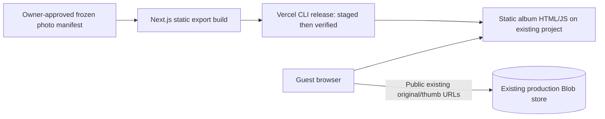

# Deployment specification — approved static album design

Date: 2026-11-02, Asia/Singapore. This is the authoritative approved design for local implementation; external account/resource gates remain pending. The user approved the static view/download design and local synthetic implementation as recorded in [the approval index](README.md#approval-record). The user requires **zero total charges, including existing services**. Existing Pro deployment is not budget-compliant at public list pricing. The selected technical target is a static Next.js album on a verified free Vercel Hobby scope, retaining the **existing project and existing public production Blob store/data/URLs** through separately approved native lifecycle operations. If that combination cannot be verified, **stop; no compliant release is established**. Do not silently fall back to Pro, a new store, copied production data, a trial or a paid destination.

## Architecture and product contract

- Keep Next/React/npm lock and existing album metadata/path helpers. Static export is configured in the existing framework layer. Reuse `GalleryClient` read/filter/lightbox/download behaviour with admin disabled; remove guest-upload controls from rendered album. No new framework, database, cache, auth provider, worker or AI integration.
- `/gallery` is the required album route; `/` and `/photos` remain static, usable paths to the album so existing QR/handout links lead somewhere useful. Preserve wedding identity and seven album grouping. Homepage video/music/story presentation is outside required journey; omit automatic external music/video loading in the album release to bound dependencies and traffic. Do not delete their remote assets or historical source evidence.
- New deployment serves no upload/login/delete/ZIP/URL-export API and no admin session. Retired endpoints must return 404/405, never execute a write. Public guests can open originals directly and download individually; a server ZIP is not required. Old deployment APIs must also be retired/protected as described below.
- Static builds consume an approved immutable **manifest artifact**, not a runtime Blob token. Manifest fields: version, capture timestamp, source store identity, record count, digest; photo records `pathname`, `url`, `thumbUrl`, `album`, `uploader`, `size`, `uploadedAt`. Private completeness evidence additionally records every store object's path, byte size, content type and available integrity fields, including unrelated prefixes. Do not publish private inventory, credentials or EXIF metadata with the album.
- Browser URLs must be HTTPS on verified original/thumb Blob hosts; path/album/metadata are validated as untrusted input, text rendered safely. Legacy paths continue mapping to wildcard. Missing thumb falls back to original. No automatic re-upload/renaming or collision overwrite.
- Manifest generation is an explicit authorized snapshot operation, not an implicit deploy side effect. Missing/truncated/stale/unapproved manifest fails build; no empty fallback. Propose fail for a public manifest over 5 MiB or over 5,000 originals pending a measured rendering/pagination review. Thresholds are proposals, not current counts or limits.
- Snapshot freshness is manual: new external objects do not appear until a later authorized snapshot/build. Uploads/admin are intentionally retired under the user's clarified scope. No automatic retention deletion. Existing public originals and their URLs remain intact.

## Prerequisites and ownership

| Owner | Required evidence/action before apply |
|---|---|
| User/product owner | Static/read-only scope and zero-total-cost constraint are approved for local implementation. Before release, verify the low/base/high model and quota-pause acceptance against actual account data, approve any still-proposed numerical latency/recovery targets, and establish zero-budget feasibility. User owns project; team billing/store/domain rights are not yet evidenced. |
| Vercel source/destination team owner | Export non-secret immutable team/project/store IDs, plan, memberships/permissions, all store/project attachments and other consumers, active add-ons/commitments, usage/quota and billing state. Confirm personal/non-commercial Hobby eligibility, repository integration restrictions and destination capacity. |
| Store owner | Confirm transfer of the **same store** preserves its ID/hostnames/bytes/access mode; enumerate shared-token consumers and media stores. Supply provider-confirmed lifecycle/rollback constraints. No automatic create/relink/copy/delete. If transfer would change original URLs or risk data, stop and redesign. |
| GitHub owner | Export branch protections, workflows, Vercel app/deploy hooks/auto-trigger settings. Disable alternative deploy paths only with separate settings approval. No push while unknown. |
| Domain/media owner | Approve existing free Vercel hostname as canonical if suitable. No new paid domain, renewal, DNS change, media service or licence. Confirm legacy aliases/QR targets and whether current external services incur album-related charges. |
| Release operator | One named user on one authorized host, minimum account permissions, approved tooling and explicit action approvals. New tooling versions are recorded; local .env/.vercel contents are not assumed trustworthy. |

Evidence gaps: live account/settings/billing, exact IDs, Hobby eligibility, transferred URL guarantees, shared dependencies, actual photo count, existing video store billing, runtime and restore behaviour. Obtain authorized read-only access or sanitized exports; public pricing cannot settle these. Previously observed team slug `jarvis-tranquilovacationrentals`, project `alice-rudolph-2026`, store `alice-rudolph-photos` are discovery hints only. Future target config must contain verified IDs, not just these names.

## Free-tier lifecycle is a separate manual gate

Official [Hobby](https://vercel.com/docs/plans/hobby), [project transfer](https://vercel.com/docs/projects/transferring-projects), [store transfer](https://vercel.com/docs/storage#transferring-your-store), and [downgrade](https://vercel.com/docs/plans/pro-plan#downgrading-to-hobby) docs were retrieved 2026-11-02. Hobby is personal/non-commercial; excess usage can pause features for up to the documented reset window. Blob transfer is **separate** from project transfer. Integrations, monitoring and drains do not all follow the project. Transfer can block settings/deployments while in progress. Publicly documented transfer time is 10 seconds–10 minutes; this is not a measured downtime promise.

Pro downgrade may remove other members; existing Hobby-team limits can require merge/deletion choices; stores/domains need manual handling. **Never downgrade the shared team, delete/merge a team, transfer a store/project/domain or cancel another service as a side effect of releasing this album.** These are individually approved lifecycle operations with a written impact list and recovery plan. Prefer an existing eligible owner-controlled Hobby destination if it can retain the project/store safely. Creating a new team/project/store is not the default solution. Team or store transfer is a departure from the currently documented scope and requires explicit ownership/config/data-affecting approval before action.

Zero total means shared Pro fees cannot simply be ignored as “already paid.” Record remaining source-team fees and whether they are unrelated obligations; do not claim the user's total service bill is zero while a subscription remains. Prior charges/remaining commitments may not be refundable. No automatic higher-tier purchase on exhaustion; accept pause or reopen budget. The final account-specific invoice/plan verification is required before declaring the cost criterion met.

## One entry point

Canonical command: `npm run release -- <plan|check|apply|verify>`, invoking [`scripts/release.mjs`](../scripts/release.mjs) from the repository root. It wraps the pinned local Vercel CLI 65.9.0; no GitHub deploy workflow, deployment API reimplementation, browser deploy or parallel wrapper. The target IDs in [`release-targets.json`](../release-targets.json) intentionally remain blank until separately approved T1 account evidence is supplied. The command refuses all modes until explicit team/project/store IDs match this allowlist.

Required targeting: `--environment preview|production` (preview default), `--team-id`, `--project-id`, `--store-id`, `--release-id`, `--manifest <absolute-path>`, and `--manifest-digest` (SHA-256 of exact file bytes). Immutable allowlists are the non-secret native `release-targets.json`; `spec/` owns the approved contract, not executable target settings. Missing IDs, unknown environment, source/destination ownership drift or an unlinked CLI context fails closed. Never infer/link/create a project from a name or current directory. Preview project ID and non-production store ID must differ from production. Test artifacts contain synthetic URLs/data only and cannot fetch production media. The manifest carries a canonical-JSON digest, source store ID, photo origin, capture timestamp and record count; the build checks its content digest and the release command binds approval to the exact file-byte digest.

| Mode | Behaviour / side effects |
|---|---|
| `plan` | Offline reads target config and an explicitly supplied immutable manifest. Writes only `.release/plan.json` with a sanitized summary. No account login, secret pull, object read, provisioning or deploy. Account facts remain unverified; this is not deploy readiness. |
| `check` | Accepts an owner-supplied sanitized metadata export using `--metadata`. Validates freshness (15 minutes), exact team/project/store/environment, manifest digest/count, target verification, exclusivity/alternate-trigger controls and absence of unexpected resources. It does not log in or query accounts; export evidence is not live verification. No secret decryption, build, snapshot, resource, plan or reset operation. |
| `apply` | Requires a fresh check export, current out-of-repository scoped approval record, a TTY operator typing `APPLY <approvalId>`, exact target match and `.vercel/project.json` linkage. `--action deploy` builds the immutable snapshot and invokes the pinned CLI with explicit project/team/environment, without auto-domain assignment on production. `--action promote|rollback` uses the CLI for the exact receipt/approved deployment. No resource creation, migration, secret pull, snapshot capture or team transfer. Mutation retries are zero. It records the outcome and leaves the local lock for reconciliation. |
| `verify` | Without `--deployment-id`, verifies only the local static health artifact. With the staged deployment URL as `--deployment-id`, runs read-only `vercel inspect`, checks READY/project, then fetches `/release-health.json` with a two-minute timeout and compares release ID, environment, project, manifest digest and count. No store mutation. |

Apply actions use the same entry point: `--action deploy` (default), `--action promote`, or `--action rollback`. Promotion requires the receipt's already verified staged production URL and `promote-production` approval. Rollback requires an exact known deployment ID and fresh sanitized metadata asserting it is an eligible compatible static release; it needs `rollback-production` approval. These commands make a single CLI mutation then record the outcome as unknown until a separate read-only reconciliation. They do not automatically retry, transfer resources, restore bytes, or remove the persistent local lock. If state is unclear, stop and reconcile manually before another action.

Approval records are external JSON containing `version`, `approvalId`, `approvedBy`, `issuedAt`, `expiresAt`, `action` (`deploy-preview`, `deploy-production`, `promote-production`, or `rollback-production`), `environment`, `releaseId`, exact target IDs and exact manifest file digest. `--approval` points to this file; it must be outside the repository and valid for no more than 15 minutes. This record is evidence from the owner-approved execution process, not permission created by the script. Apply rejects non-TTY execution, stale/mismatched approval, wrong target/link and missing account-check evidence. The operator types the full approval ID, action, environment and project in the confirmation phrase. No credentials are included in the record.

### Required permissions

- `plan`: repository read, manifest read and local write to ignored `.release/`; no network or provider identity.
- `check`: same plus owner-supplied sanitized metadata file; it performs no account login or provider query. A separately authorized operator must obtain a read-only export that covers project/team/store identity, plan/quota, domains/protection, triggers, active deployment and lease state.
- local `verify`: repository/build artifact read only. Remote `verify` needs authenticated read access to the selected project/deployment and network GET of its generated `.vercel.app` health URL.
- `apply deploy`: Node/npm, exact pinned local Vercel CLI, approved immutable manifest and its origin, explicit project/team access to create a deployment, plus local write access for build/export and lock/receipt. It does not need Blob, database, domain/DNS, secret-management, team-transfer, or storage-write permission.
- `apply promote|rollback`: only separately approved deployment management permission for the exact project/release action, plus current account-check data. The wrapper does not need storage write or DNS permission.

No GitHub deployment workflow is installed by this implementation. If a future execution moves to CI, the environment must add an owner-approved protected approval process before non-interactive apply can be enabled; the current wrapper deliberately rejects non-TTY apply.

A new project can have different first-deploy semantics: an explicit preview target and remote metadata verification are mandatory. A preview is never a production build to be promoted: production must be built with production configuration and a separately approved production manifest. Production staging exposes a generated URL; its public data exposure is a gated production operation even before alias assignment.

Clean checkout means the approved source commit matches the release, with no tracked modifications or unreviewed build inputs; manifest is a verified external input with digest/provenance. Local ignored secrets/build files must not be uploaded. Future `.vercelignore`/framework output checks must exclude `.env*`, local linkage, review exports, private inventories, raw photo downloads and scratch data, while allowing the deliberate public manifest-derived bundle. No build hook may capture live production data or provision resources. Static app/build consumes no Blob/admin secret; any remaining automatically injected integration variables must be explicitly reviewed/removed from build targets under separate settings approval, with no revocation of other consumers by accident.

Tooling: `.nvmrc` and `package.json` constrain Node to 24.x; the npm lock pins Vercel CLI 65.9.0, ESLint 9.39.5 and `eslint-config-next` 16.2.6. The native Node test runner covers release and manifest guards. Playwright Core remains available for a later separately authorized browser E2E run; browser E2E was not performed in this local stage. The static build consumes the absolute manifest path only at build time and exports static HTML/JS plus `release-health.json`.

## Concurrency, repeatability, drift and failure recovery

- **Single writer:** one named operator/host per approved window. Owner records an exclusive deployment/config lease covering both source/destination teams and verifies all other CI/Git/deploy hooks are disabled/blocked. Local atomic directory lock keyed by team/project prevents concurrent wrapper processes, held through verification/promotion. Record PID, host, release ID and timestamps; restrictive permissions. No distributed lock service added.
- Local lock alone is not cross-host exclusion. If the owner cannot attest/enforce exclusive access or another remote deployment/config change appears, **stop apply**. Do not pretend a local lock makes uncontrolled dashboard/other-host activity safe. Before each mutation, re-read target/config fingerprint and active deployment; optimistic compare against checked plan.
- Plan/check fingerprint covers commit, lockfile/toolchain/config, manifest digest, target IDs, environment binding versions, plan/quota snapshot, current production deployment, trigger/lease state and approval scope. Proposed validity: 15 minutes for mutation preflight; recheck after lifecycle/config change. A stale plan produces drift and requires a fresh plan/approval if material.
- Release receipt maps release ID+input digest+target to deployment ID and status in a private operator directory; sanitized summary goes under `review/validation/`. Repeat apply for a completed receipt verifies/reuses the known deployment. Same release ID with changed inputs fails. If remote request outcome is unknown, inspect deployments by metadata/receipt before retry; never blindly resubmit. Deployments are release artifacts; repeat runs must not create duplicate **durable resources**.
- Routine apply never creates DB/store/project/domain/token. Resource count/identity differences are drift, not repair instructions. No database exists; any detected database or unexpected binding is a stop pending ownership review. Intentional drift correction needs a scoped plan and separate approval.
- Proposed bounds: account read/probe 10s per attempt; at most 3 total attempts for safe reads, backoff 1s then 2s with small jitter, obey Retry-After only within 30s total. No retries for auth/permission/schema/target failures. Build/deploy poll budget 20min, promotion/rollback status 3min, health verification 2min. These are operator bounds for approval, not measured speed. Remote state can continue after timeout: record “unknown,” retain lease, reconcile; never report cancellation merely because local process exited.
- Mutations have **zero blind automatic retries**. SIGINT/error records sanitized partial state, terminates local child where safe, preserves receipt/lock until remote outcome is reconciled. A stale lock is released manually only after checking PID/remote operation and renewing the lease. No age-only deletion of locks.

## Snapshot, compatibility and migration safety

This is an application/config rebuild with feature retirement, not a storage migration or DR restore. Sequence:

1. **Inventory/expand:** authorize minimal production metadata/object access; enumerate readers/writers, paths, all prefixes and credentials. Capture current domain/deployment/config/byte-count evidence. Keep production serving; no deletes/copies/renames.
2. **Freeze writes:** owner approves retirement of old guest/admin API capabilities across *all* deploy URLs/aliases. Protect/remove legacy access and revoke the legacy Blob token only after verifying no other consumer relies on it and recording effects. Env removal alone does not revoke tokens embedded in old deployments. Token revocation/creation and old-deployment protection are manual security/data-affecting operations, separately approved. Public object GETs must remain usable. Do not rotate the admin password merely to rebuild.
3. **Capture:** use an owner-supplied appropriately scoped temporary credential (if provider only offers read-write, disclose privilege and confine it to operator), never shipped to Next build/runtime. Complete paginated listings; no swallowed errors. Compare two inventories after freeze for identical paths/sizes/metadata. Fetch/check bytes only under explicit data-access authorization. Write protected external manifest artifacts with SHA-256 digests, not raw photo bytes in Git/logs. Confirm all eligible originals represented and fallback/legacy mapping. Revoke temporary token after capture if safe and authorized.
4. **Build/preview/verify:** use synthetic fixture manifest + isolated approved test environment first; no production originals as test fixtures. Reuse existing helpers; static export produces no runtime handlers/secrets. Tests prove legacy reads and disabled writes. Maintain a verified static fallback artifact before lifecycle cutover if possible within approved free resources.
5. **Lifecycle/cutover:** only after separate transfer/billing and production approvals; confirm store stays same, project targets/aliases documented, byte inventory unchanged and public URLs still work. Recompute release config/plan after transfer. Build production from approved snapshot, stage, health-check, then promote. The owner must approve ordering against actual provider prerequisites; transfer cannot be simulated by creating a new store. Do not combine team transfer and app promotion into an opaque retryable command.
6. **Verify, then contract:** compare all counts/digests, representative original bytes, domains and old API retirement. Keep historical source/audit evidence. Future refresh is explicit capture+release under same gates. No destruction/data cleanup is included in contraction.

Mixed versions: old dynamic code can still list/read new-compatible existing paths while credentials remain; old upload tokens may remain valid until expiry/revocation. Do not claim write freeze until issuer credentials and issued-token lifetime are handled/verified. After token revocation old dynamic deployments may fail; record them as ineligible rollback targets. Cached public originals may remain accessible after future delete/revocation: no privacy erasure guarantee. New static build has no writer and uses unchanged URLs. No DB schema migrations, no URL/path conversion and no automatic external side effects.

## Health, observability and success/failure policy

- Static health is an artifact `release-health.json` with non-secret release ID, commit, capture timestamp, manifest digest/count and schema version. It proves which artifact is served, not current Blob health. Publishing complete object inventory/private paths in this file is prohibited.
- Before promotion: deployment READY, expected environment/project, `/`, `/photos`, `/gallery` successful, exact known manifest count/album grouping, valid links, no retired POST route executes, no production credentials in preview. Do not use a nonempty HTML page as sufficient health.
- Public dependency probes use owner-approved known original/thumb (or synthetic fixture in test), verify status/content type and size/hash as authorized. A deliberately empty fixture is valid only when its signed-off manifest count is zero; production empty/partial snapshot is a failure unless separately approved against inventory.
- Candidate health failure: leave current aliases unchanged, preserve candidate evidence, exit nonzero, no retry deployment or mutation of storage. After promotion failure: use only preauthorized, verified compatible static rollback target; otherwise stop and request the incident decision. Never restore a broken dynamic deployment whose credential has been revoked.
- Observability: use existing platform deployment/error/usage facilities only within free plan; no new paid drain/monitor. Wrapper emits allowlisted status, timing, counts and opaque IDs; suppress raw CLI env/stdout/debug dumps, passwords, cookies, tokens, guest names, file paths and URL query secrets. Tests inject canary credentials to check redaction. Runtime gallery is static; browser dependency failures require user-visible retry/download fallback and do not justify an empty-album success claim.
- Owner checks quota and serving status before releases and on reported outages. Proposed manual monthly quota review; no paid polling or automation installed. Quota pause → record incident, communicate availability limit, wait for reset or obtain a new cost approval; never silently upgrade. A monthly review cannot prevent an adversarial burst. No uptime guarantee under strict free quotas.

## Backups, rebuild, restore and rollback

- User has no essential retention/backup requirement. Default **retain all existing objects**, no lifecycle delete and no automatic paid backup. A metadata manifest is not a backup of bytes. Record that store deletion/corruption/account loss may be unrecoverable without an independently retained copy. No RPO/RTO for disaster recovery is established.
- Before any operation that risks data/ownership, require either a verified owner-held complete byte backup or explicit owner acceptance of the documented lack of recoverability for that operation. “Not essential” is not permission to delete photos. If risk cannot be controlled without intentional loss, stop.
- Optional owner-local backup: authorized paginated inventory + per-object downloads, include originals/thumbs/video/other prefixes, capture path/type/size/SHA-256 and an error ledger; incomplete download exits failure. Protect destination, exclude from Git, confirm capacity. No schedule/copy destination purchased. Restore rehearsal uses synthetic objects and separately approved non-production store.
- Application rebuild: clean source + approved toolchain + snapshot → same static album against **existing** object URLs. No data copy required. DR restore: recovering bytes into an approved surviving/replacement store, restoring metadata and URL mappings, checking integrity, then republishing; replacement IDs/hostnames may change and require a new migration design/approval. Cannot automatically recreate accounts, credentials, domain control, provider assets, lost bytes, original hostnames, old paid entitlements or billing history.
- Code rollback: same CLI wrapper invokes `vercel rollback <verified eligible deployment>` or an approved compatible static release. Confirm target is available, previously production-aliased where required and healthy with present config. This changes serving code/routing, **not** store/team transfer, token revocation, billing, deletes, uploads, data migrations or other external effects. Provider transfer reversal is separate and may not be instantaneous/available/free. After rollback inspect domain auto-assignment state; do not re-enable Git deployment automatically.
- Retain source lockfile, manifest digest, static artifact and previous known-good deployment within verified free retention/capacity. If no eligible free rollback target/artifact exists, production release is blocked until owner accepts/revises recovery plan; no paid retention is silently enabled.

## Manual exceptions

Account login/SSO, read-only exports denied to connectors, billing/plan change, project/store/domain transfer, legacy token revocation, initial snapshot access, backup decisions and emergency alias recovery require a named human operation, explicit scoped approval, preconditions, recorded non-secret before/after evidence and postcheck through the same plan/check/verify contract. They are not a second deployment entry point. Dashboard deployment is not a routine fallback. An emergency exception must state why the CLI cannot execute the approved recovery; no implicit break-glass authorization. Current stop: T1 cost, ownership, target, trigger, and same-store continuity evidence is not authorized or verified.
